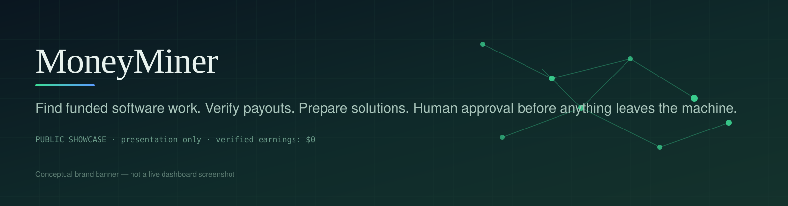
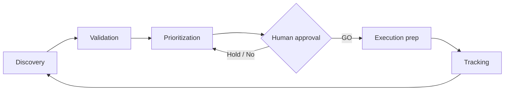
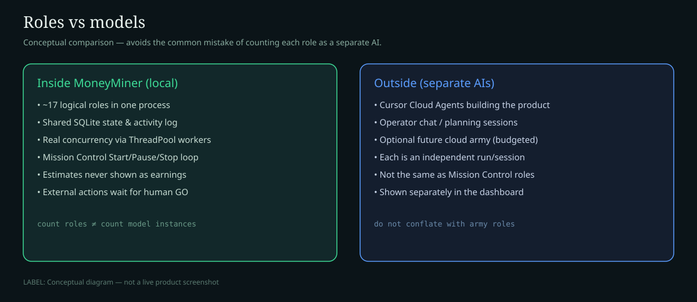
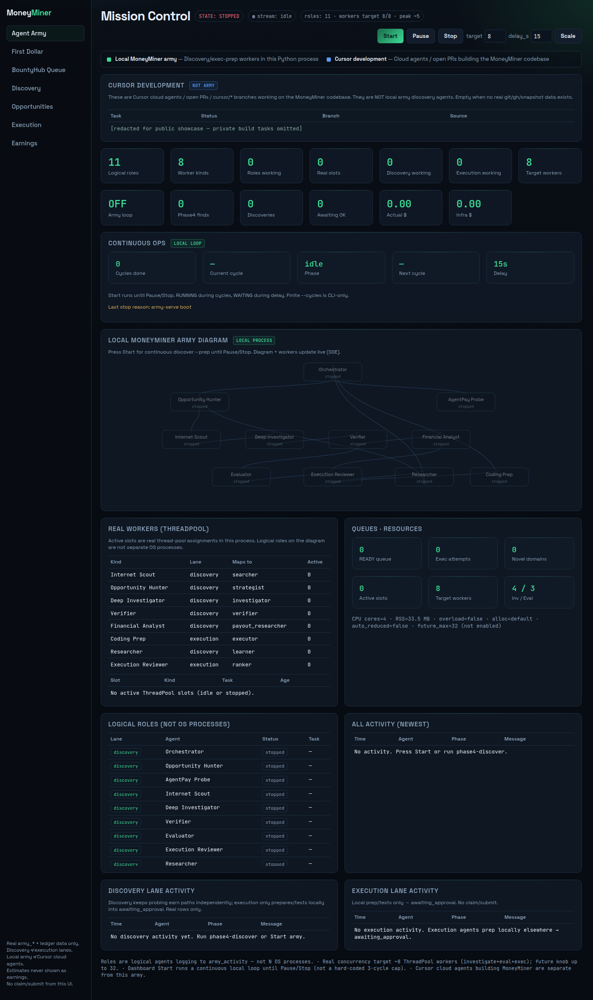
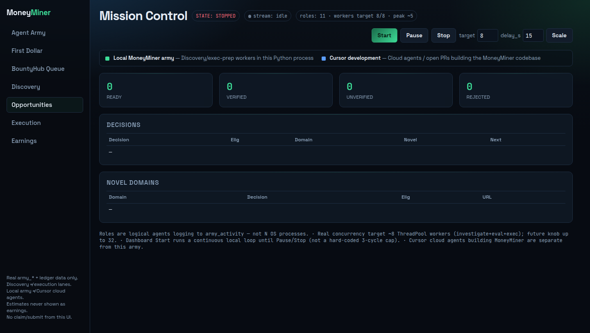
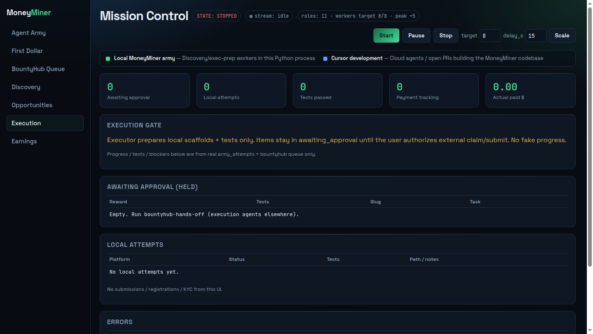
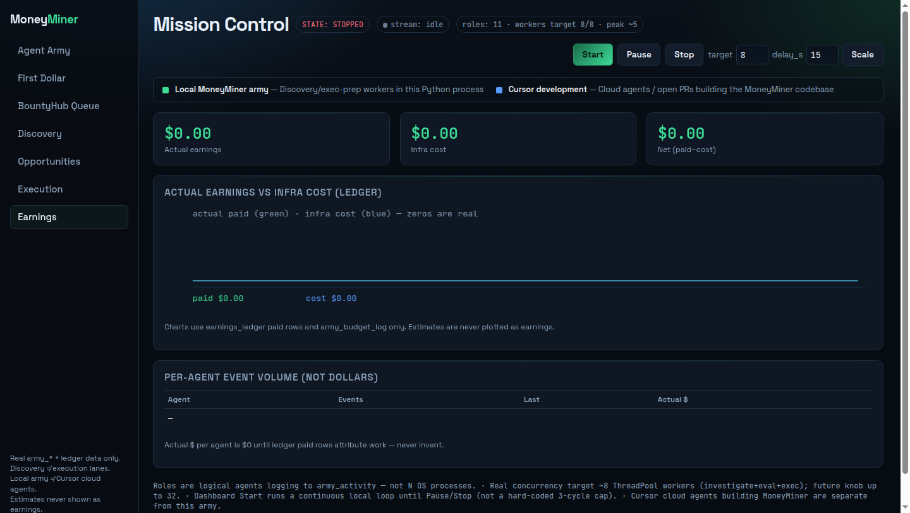
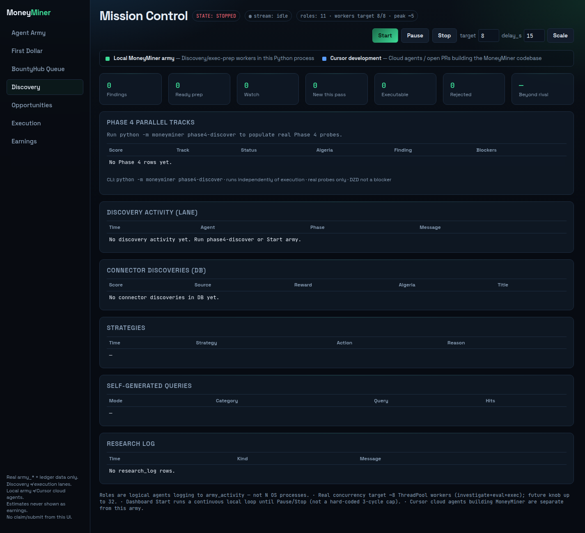

# MoneyMiner

**MoneyMiner** is a local **Mission Control** system for finding legitimate, funded software work, checking whether payouts are real, preparing solutions offline, and waiting for a human before anything is submitted.

This repository is a **public portfolio showcase** (README, diagrams, and redacted screenshots). It is **not** a release of the private product source code.

| | |
|---|---|
| **What it is** | Operator cockpit for discovery → validation → prep → approval → tracking |
| **What it is not** | A SaaS, a bot that spends money, or an autonomous payout machine |
| **Verified earnings** | **$0** (ledger shows actual paid only — never estimates) |
| **Visibility** | This showcase repo is public; the product codebase stays private |

---

## Overview

MoneyMiner helps a solo operator (or small team) treat paid software work like an operations problem:

1. **Discover** funded coding tasks and software jobs across legitimate public sources  
2. **Validate** funding, competition, payout terms, and AI-policy fit  
3. **Prioritize** what is worth preparing next (including “first realistic dollar” ranking)  
4. **Pause for a human** before claims, applications, registrations, or spending  
5. **Prepare** local patches, tests, and truthful proposal drafts  
6. **Track** claims, invoices, confirmations, and actual receipts — without inventing earnings  

Mission Control makes the army’s state visible: roles, workers, queues, decisions, and a truthful earnings panel that stays at **$0** until real ledger “paid” rows exist.

---

## Real capabilities

| Capability | What it does | Guardrail |
|---|---|---|
| Continuous research loop | Start runs until Pause/Stop (not a fixed 3-cycle demo) | Local process only |
| Multi-source discovery | Public boards / bounty listings / open web signals | Read-oriented; no silent signup |
| Validation & scoring | Funding, competition, payout path, eligibility labels | Missing signals stay unknown |
| Human approval gate | External claim/submit waits for the operator | No auto-spend |
| Local execution prep | Scaffolds + tests held in *awaiting approval* | No claim from the UI |
| Proposal drafting | Concise, truthful expressions of interest | Drafts ≠ sent messages |
| Payment tracking | Advertised vs confirmed vs earned | Earned = ledger `paid` only |
| Mission Control UI | Live diagram, workers, queues, lanes | Estimates ≠ earnings |

**Honest status:** MoneyMiner is an active engineering project. Screenshots below are from a real local Mission Control session with an empty sample database (no proprietary leads). Verified operator earnings remain **$0**.

---

## Architecture

*Caption: Conceptual pipeline SVG. Stages match the product loop; this image is labeled conceptual art, not a Mission Control capture.*

### Pipeline (operator-readable)

| Stage | Job | Example roles |
|---|---|---|
| **Discovery** | Find funded software work | Paid Opportunity Hunter, Internet Scout, Niche Bounty Scout |
| **Validation** | Check funding, competition, payout terms | Verifier, Competition Analyst, Payout Terms Verifier, AgentPay Probe, Deep Investigator |
| **Prioritization** | Rank what to prepare next | Evaluator, Execution Reviewer, First-Dollar Prioritizer |
| **Human approval** | Operator decides claim / apply / spend | Outside the army — hard gate |
| **Execution prep** | Local fix + tests + EOI draft | Coding Prep, Proposal Agent |
| **Tracking** | Claims, replies, receipts | Payment Tracker, Sponsor Reply Monitor |

Orchestrator + Researcher close the loop (control + learning). Together that is **~17 logical roles** (original core set plus paid-work specialists).

### Logical roles ≠ separate AI models

*Caption: Conceptual comparison. Mission Control roles share one local process; Cursor/cloud agents that build the codebase are separate runs.*

MoneyMiner’s “army” is a set of **logical roles** that log activity and share ThreadPool workers inside **one local Python process**. Counting 17 roles does **not** mean 17 independently running AI models. Separately, Cursor Cloud Agents (or other chat sessions) may build the product — Mission Control labels those as development, not army work.

---

## Tech stack (high level)

- **Language:** Python 3.10+ (stdlib-first local tooling)  
- **Storage:** Local SQLite for activity, queues, and an earnings ledger (private; not shipped here)  
- **UI:** Local Mission Control dashboard (bind to `127.0.0.1`)  
- **Concurrency:** ThreadPool workers for investigate / evaluate / prep phases  
- **Integrations:** Read-only connectors to public opportunity sources; external writes only after human GO  

Private implementation details, prompts, and strategy docs are intentionally omitted from this showcase.

---

## Mission Control (real screenshots)

These captures are from a **real** local Mission Control session using an **empty sample database**. Private build-task lists were redacted. No tokens, bank details, or proprietary opportunity leads are shown. The live UI on this machine reported the base role set (`roles: 11`); the architecture section above describes the full **~17-role** design including specialists.

### Agent Army

*Alt / caption: Mission Control → Agent Army. STATE STOPPED. Logical roles and ThreadPool workers idle. Cursor development table redacted for the public showcase. Actual $ = 0.00.*

### Opportunities

*Alt / caption: Opportunities panel with sample-empty decisions. READY/VERIFIED/UNVERIFIED/REJECTED all 0.*

### Execution gate

*Alt / caption: Execution gate. Local prep only; awaiting approval empty; Actual paid $ = 0.00. UI cannot claim or submit.*

### Earnings (truthful zeros)

*Alt / caption: Earnings ledger. Actual earnings $0.00, infra cost $0.00, net $0.00. Chart notes that zeros are real — estimates are never shown as paid.*

### Discovery

*Alt / caption: Discovery lane on an empty sample DB (no live leads displayed).*

### Screenshots the operator may still want to add

If you run Mission Control against richer (still redacted) sample data, useful extras are:

1. Army diagram with several roles marked *working* (no private URLs in activity text)  
2. A sanitized *awaiting approval* row with fake slug names only  
3. Optional short screen recording (45–90s) following [`docs/demo-storyboard.md`](docs/demo-storyboard.md)

Do **not** invent screenshots or pass mockups off as live UI. Conceptual SVGs above are clearly labeled.

---

## Annotated features

### Continuous Mission Control
Start / Pause / Stop control a local research loop. Worker target is configurable (safe local ceiling; future scale is budget-gated).

### Discovery ≠ execution
Discovery probes and execution prep are separate lanes in the UI. Finding a listing is not the same as claiming it.

### Human-in-the-loop finance
Registrations, applications, claim PRs, and spending wait for the operator. The product is designed to **prepare**, not to go rogue.

### Truthful money panel
Advertised rewards and scores are not earnings. Only ledger rows marked paid count as actual money — today that total is **$0**.

---

## Getting started (understand — not run)

This public repo is presentation-only. There is **no** runnable MoneyMiner source here.

1. Read this README and the architecture diagrams  
2. Skim the Mission Control screenshots to see the operator cockpit  
3. Read [`docs/upwork-description.md`](docs/upwork-description.md) for a short client-facing blurb  
4. Read [`docs/demo-storyboard.md`](docs/demo-storyboard.md) for a 45–90s walkthrough script  

If you are the operator with access to the private product checkout, run Mission Control locally on loopback only — never expose it publicly.

---

## Security & privacy

- **No secrets** in this repository (no tokens, `.env`, bank details, or SQLite dumps)  
- **No private prompts**, strategy playbooks, or internal issue logs  
- **No** linking to the private product repository as if it were public  
- Screenshots use sample/empty data; Cursor build tasks redacted  
- Earnings claims stay honest: **$0** verified received  
- Mission Control is intended for **localhost** use  

See [`SECURITY.md`](SECURITY.md) for the public audit checklist.

---

## Project status (truthful)

| Item | Status |
|---|---|
| Mission Control UI | Real local dashboard (screenshots above) |
| Logical army roles | ~17 designed (core + specialists); live capture showed base 11 on sample DB |
| Verified earnings | **$0** |
| Autonomous payouts | **Not a feature** — human approval required |
| Public source release | **No** — this repo is showcase-only |
| Suitable for Upwork portfolio | **Yes** — as a systems / automation case study |

---

## Demo & Upwork copy

- Storyboard: [`docs/demo-storyboard.md`](docs/demo-storyboard.md)  
- Upwork description (&lt;600 chars): [`docs/upwork-description.md`](docs/upwork-description.md)  

---

## License

Documentation and media in this showcase are provided for portfolio demonstration. Product source remains private. See [`LICENSE`](LICENSE).
